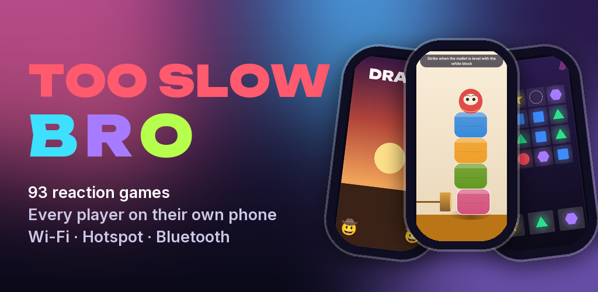
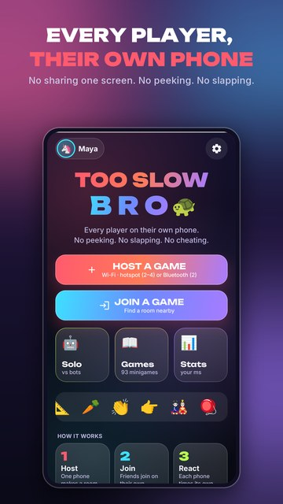
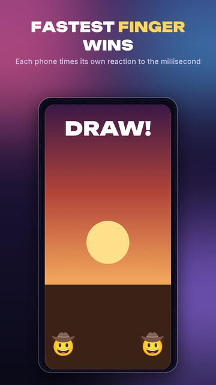
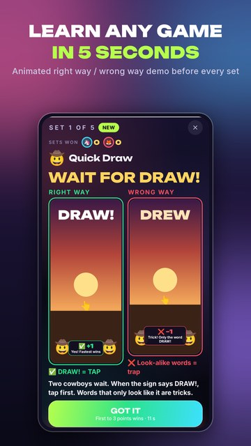
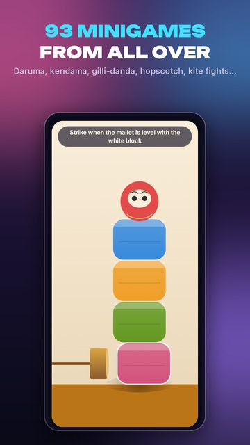
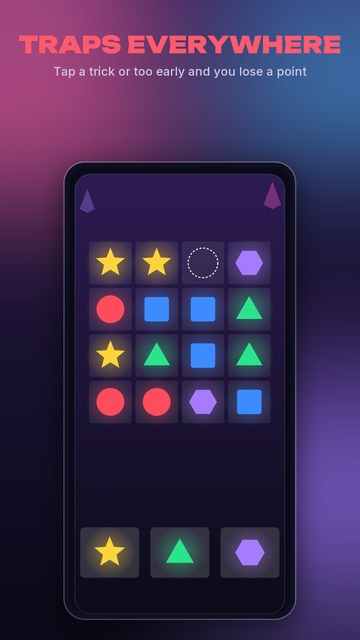
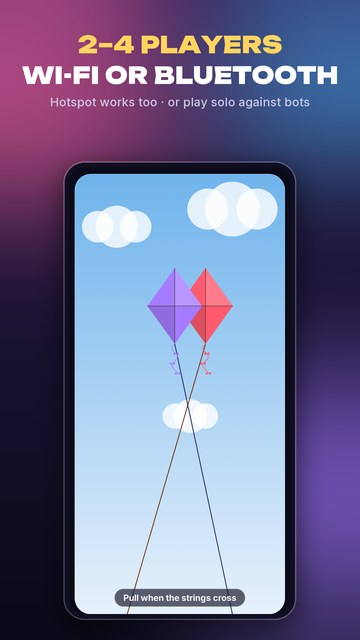

<h1 align="center">Too Slow Bro</h1>

<b>93 reaction games for 2–4 friends — every player on their own phone.</b> 
No shared screen. No peeking. No slapping. No cheating.

## Why another reaction game?

Most party reaction games put everyone on **one shared screen**: someone blocks it, someone peeks, someone slaps early.
Too Slow Bro gives every player their **own phone**. The phones connect over the same **Wi-Fi**, a **phone hotspot** (2–4 players) or **Bluetooth** (2 players) and compare results instantly.

## How it stays fair

- **Each phone times its own reaction**, from the frame the signal is drawn on *that* screen to the moment *that* finger touches it.
- The network is only used to start rounds together and to share results — **lag never decides who wins**.
- Faster than 100 ms counts as a false start, the same rule sprinters use.
- Traps and fake-outs: tap a trick or tap too early and you lose a point.
- "Closest wins" timing games also need a real hit — the block has to land on the stack, the arrow on the bullseye.

## Screenshots

  
  

## Features

- **93 minigames** across reflex, timing, matching, brain and board games, including games from around the world: Daruma Drop, Kendama Catch, Gilli-Danda, Kite Fight, Hopscotch, Rock Paper Scissors, Look That Way!
- **Learn any game in 5 seconds** — an animated *right way* and *wrong way* demo before each set.
- **Sets and matches** — one game per set, first to 3/5/7 points; best of 5/7/9/11 sets or all your games, in a new random order every match.
- **Your own playlist** — pick the games and the difficulty.
- **Bots** — fill empty seats or practise solo against Rookie, Pro or Cyber bots.
- **Stats** — best and average reaction times, results per game and against each friend, all kept on your phone.
- **Themed scenes and music** for every game, plus haptics.
- No account, no sign-up. Play offline with friends nearby.

## All 93 games

### ⚡ Reflex (28)

| Game | How to win |
|---|---|
| Green Light | Tap the moment it turns GREEN |
| Bait & Switch | Tap ONLY on green. Other colours are traps |
| Quick Draw | Shoot when it says DRAW! |
| Blind Reflex | Don't look! Tap on the beep or the buzz |
| Whack Target | Smash every target. Fastest total wins |
| Penalty Save | Tap the side the ball flies to |
| Mole Mash | Hit the moles, not the bombs |
| Firefly Catch | Tap when the firefly lands on the leaf |
| Fishing Bite | Tap on the big dunk, not the nibbles |
| Ninja Dodge | Tap the side away from the star |
| Haunted Windows | Tap on a ghost, never a cat |
| Frog Tongue | Tap when the fly is in range |
| Slap the Hand | Tap when the hand crosses the line |
| Lightning | Tap on the real lightning bolt |
| Blow Out | Tap fast to blow the candle out when it lights |
| Basket Swish | Tap when the ball drops through the net |
| Egg Hatch | Tap when the chick pops out |
| Chicken Crossing | Tap to cross when the road is clear |
| Swipe Sort | Swipe fruit left, veg right |
| Clap! | Tap to clap the moment the screen flashes |
| Look That Way! | Look any way except where the finger points |
| Kite Fight | Pull when the kite strings cross |
| Air Hockey | Tap the side the puck is heading to |
| Fruit Slice | Tap every fruit, never the bomb |
| Duck Shoot | Tap the duck, not the swan |
| Gap Flyer | Tap when the gap lines up with the bird |
| Pancake Flip | Flip it when it turns golden |
| Toast Pop | Tap the moment the toast pops up |

### ⏱️ Timing (16)

| Game | How to win |
|---|---|
| Countdown Zero | The count vanishes. Tap when it hits 0 |
| Stop the Clock | The clock fades. Stop it on the target |
| Balloon Pop | Tap as late as you dare, before it pops |
| Perfect Pour | Stop at the line. Don't overflow |
| Pendulum | Stop it as it passes the centre |
| Spinner | Stop the needle on red |
| Parking | Stop as close to the wall as you can |
| Daruma Drop | Strike when the hammer lines up with the loose block |
| Kendama Catch | Tap when the ball is right above the cup |
| Face Puzzle | Drop each face part right where it belongs |
| Gilli-Danda Strike | Strike the stick at the top of its flip |
| Archery | Shoot when the sight is on the bullseye |
| Golf Putt | Stop the power bar on the flag line |
| Perfect Stack | Drop the block right on top of the stack |
| Laser Cannon | Fire when the alien is right above your cannon |
| Bottle Flip | Tap the moment it lands on its neck |

### 🔍 Match (24)

| Game | How to win |
|---|---|
| Color Twins | Tap when both colours MATCH |
| Shape + Color | Tap when shape AND colour both match |
| Stroop | Tap when the WORD matches its INK colour |
| Three of a Kind | Tap when 3 identical symbols show |
| Odd One Out | Find and tap the odd one |
| Dice Eyes | Tap on a PAIR |
| Shape Count | Tap when the count hits the target |
| Cup Shuffle | Follow the ball, then tap its cup |
| Emoji Hunt | Find the emoji shown on top |
| Arrow Trick | Tap where the arrow points |
| Spot the Change | Tap the one thing that's different |
| Mirror | Tap when they're mirror images |
| Letter Hunt | Find the odd letter |
| Birds on a Wire | Tap when there are exactly five birds |
| Sock Pairs | Find the two socks that match |
| Turned Twin | Tap the same shape, just turned |
| Longest Line | Tap the longest line |
| Rock, Paper, Scissors! | Tap the hand that beats theirs |
| Hopscotch | Tap the square the stone lands on |
| Bingo Call | Tap when the called number is on your card |
| Bubble Colour | Tap the bubble that matches your shooter |
| Slot Jackpot | Tap when all three reels match |
| Say Cheese | Snap the photo when everyone smiles |
| Sushi Train | Tap when your order rolls up |

### 🧠 Brain (18)

| Game | How to win |
|---|---|
| Quick Math | Tap if the equation is TRUE |
| Bigger Number | Tap the BIGGER number. Ignore its size |
| Flag & Capital | Tap when the capital matches the flag |
| Population Duel | Tap if the statement is TRUE |
| Word Hunt | Tap when the word fits the category |
| Illusion | Tap only if they are EXACTLY equal |
| Copycat | Watch the pattern, then tap it back |
| Flash Grid | Remember the numbers, tap them in order |
| Memory Pairs | Remember them, then tap a matching pair |
| Count the Flashes | Count the flashes, tap the number |
| What Comes Next | Tap what comes next in the pattern |
| Make 10 | Tap two numbers that add up to 10 |
| Flash Word | Read the flash, tap the word you saw |
| Bigger Area | Tap the shape that covers more space |
| Finger Count | Tap the total number of fingers |
| Twenty-One | Tap when the cards add up to exactly 21 |
| Peekaboo | Tap the bush the bunny hid behind |
| Clock Reader | Tap the clock that shows the time |

### 🎲 Board (6)

| Game | How to win |
|---|---|
| Schulte Race | Tap 1, 2, 3… in order. Fastest wins |
| Tic-Tac-Toe | Tap the moment someone WINS |
| Four in a Row | Tap the moment four CONNECT |
| Maze Link | Tap when the path links corner to corner |
| Fit the Piece | Tap when the block fits the hole |
| Match Three | Fill the hole to make three in a row |

### 📱 Motion (1)

| Game | How to win |
|---|---|
| Tilt Maze | Tilt your phone to roll the ball in |

## Privacy

The app has no account and no server: your nickname and results stay on your phone and the phones you play with. A banner ad is provided by Google AdMob.
Read the full **[Privacy Policy](PRIVACY_POLICY.md)**.

## Permissions

| Permission | Used for |
|---|---|
| Internet, network & Wi-Fi state, multicast | Finding and joining rooms on your Wi-Fi or hotspot; loading ads |
| Bluetooth | 2-player games without Wi-Fi (not used for location) |
| Location (Android 10–11 only) | Required by Android for Bluetooth scanning on those versions; never read |
| Vibration | Haptic feedback |

## Get it

Coming soon on Google Play.

## Support

Found a bug or have an idea for a minigame? [Open an issue](../../issues).

---

© 2026 S0ulSh3ll. All rights reserved. Fonts: Unbounded and Inter (SIL Open Font License). Sound effects: Kenney (CC0).
